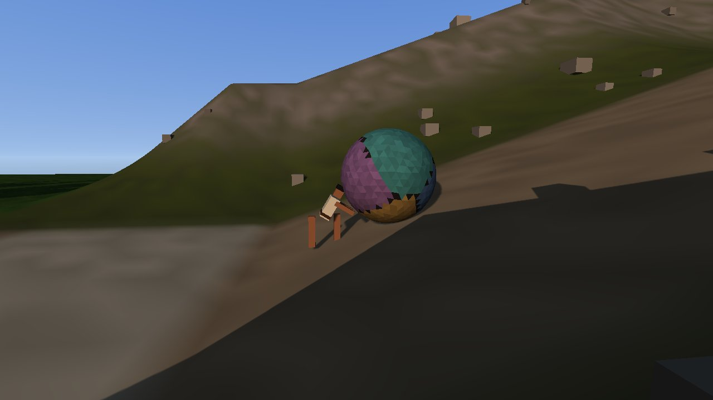
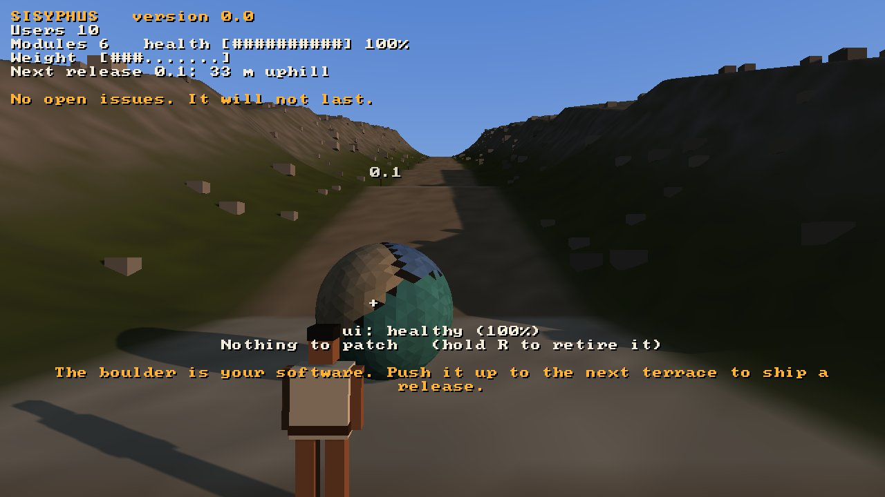
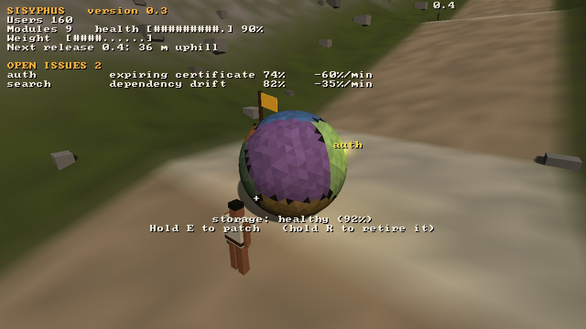
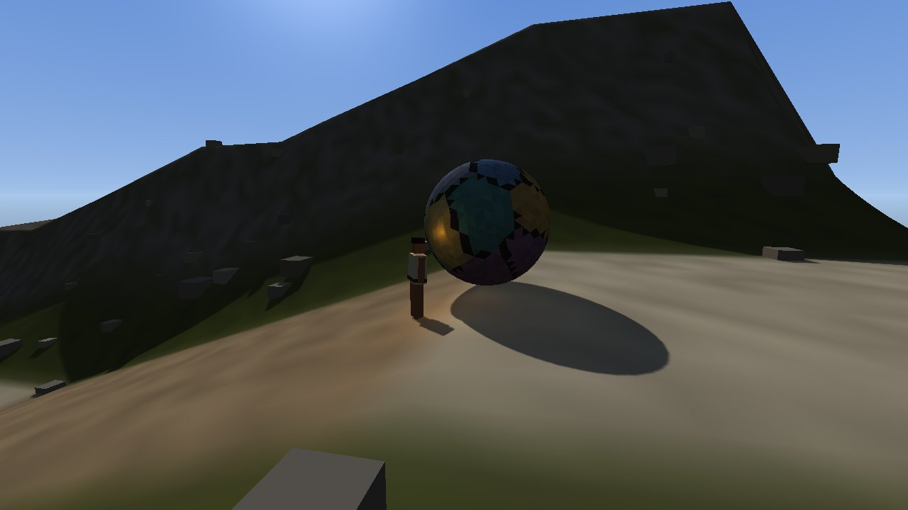
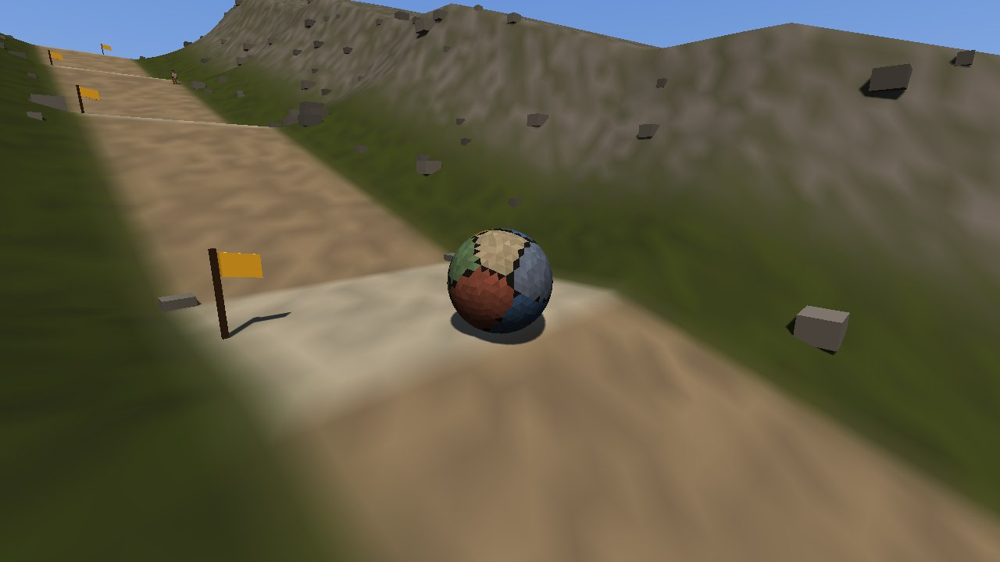
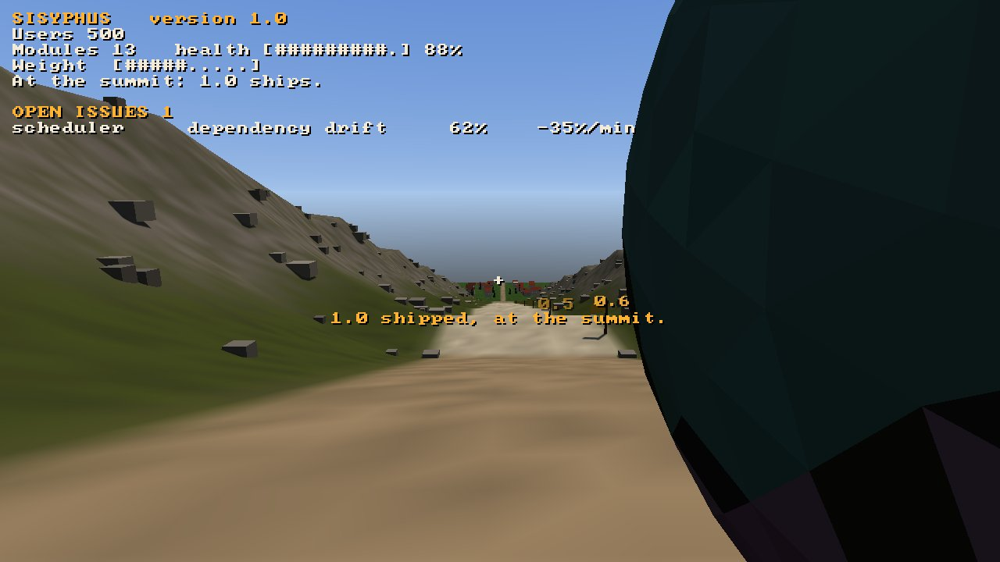
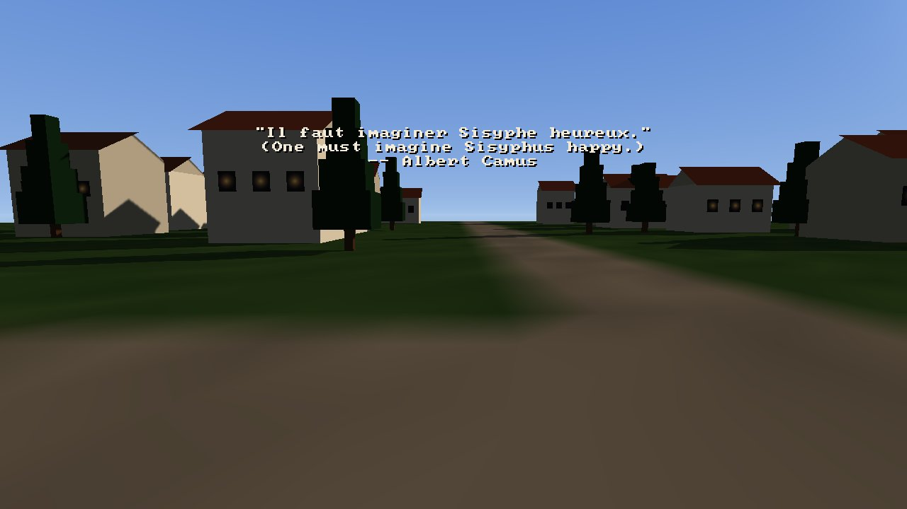

# Sisyphus

A first-person game about keeping software alive, on the [Strata](https://github.com/Preponderous-Software/strata) engine.

The boulder is your software. Push it up the hill: every terrace you reach ships a release. Every release adds a
module, so the boulder grows. Every module rots, slowly on its own and fast when something happens to it. A dependency
drifts three majors behind, a test turns flaky, an API is deprecated, a certificate is about to expire, a security
advisory lands and spreads to the module next to it. Modules use one another, too: when one goes down, everything that
uses it rots fast until it is patched, and red lines on the stone show where the outage spreads. Rot makes the boulder
heavy. Too heavy, and it slides back down
the slope however hard you push. A module rotted through goes down, and the town's lit windows in the valley below go
dark one by one as its users leave.

So you stop on a terrace and walk round the stone, patching. A module stuck underneath can't be reached, so you roll
the boulder to bring it round. A module not worth keeping can be retired, and some users miss it. Or it can be refactored into the
module it uses: slower work, no users lost, the code that is left is new, though now and then it breaks a test. Then
you push on. Pushing wears you out,
the heavier the boulder the faster, and tired you push and patch slowly: sit down on a terrace and rest. Showers come and go: rain makes the path slick, so the boulder is slower to push and
quicker to roll back, and the seasons turn every few days (in winter it snows, and certificates expire twice as often).
Now and then, at a release, someone comes up from the town to help: they
patch what they can reach while the boulder rests, then move on, and the module they knew best starts to drift.

At the summit the next major version ships. Then the platform under it reaches its end of life, and the boulder rolls
all the way back to the trailhead with every old module still aboard. The next major version starts there: more code,
older code, faster rot. Unless, at the top, you hold R and rewrite it: then it starts again light, with a few fresh
modules, and most of the users do not follow. A cairn is raised beside the path there for the version that shipped: stand at one to read how
its climb went. Over a long game they pile up. There is no end. You can always sit down and look at the view.



| | |
|---|---|
|  |  |
|  |  |
|  |  |

*Screenshots from the game's own headless playthrough (`sisyphus --headless --frames DIR`), rendered by Strata.*

## Download

Windows and Linux builds are on the [releases page](https://github.com/Preponderous-Software/sisyphus/releases)
(0.3.1 is a pre-release). Unzip and run `sisyphus.exe`, or `./sisyphus` on Linux; each needs an OpenGL 4.5 driver.
Or play it in a browser at https://sisyphus.play.danielstephenson.dev.

## Playing

| | Keyboard and mouse | Touch (browser) |
|---|---|---|
| Look | mouse | drag on the right half |
| Walk; push (walk into it from below) | `W` `A` `S` `D`, `Shift` to hurry | drag on the left half |
| Roll it back to turn it (on a terrace, from above) | walk into it from above | the same |
| Patch the module you look at | hold `E` | hold **Patch** |
| Retire it (one less thing to keep) | hold `R` | hold **Retire** |
| Refactor it into the module it uses | hold `F` | hold **Refactor** |
| Sit and look at the view | `Q` | **Sit** |
| Every climb so far | `Tab` | **History** |
| From behind him, or back to his eyes (the default) | `V` | **Camera** |
| Save / load the last save | `F5` / `F9` | **Save** |
| Controls on screen / free the mouse | `F1` / `Esc` | |

The HUD says the version, the users, the codebase's health and weight, how far it is to the next release, and the
open issues, worst first. Weight comes from the number of modules and from their rot. At full weight the boulder
won't go uphill, though on level ground it can still be inched along.

## Building

You need CMake 3.24 or newer and a C++17 compiler. Strata, with SDL3 and the rest, is fetched at a pinned commit (the v0.6.0 tag).

```sh
cmake -S . -B build
cmake --build build -j
./build/sisyphus                 # play; continues from the save in ~/.local/share/sisyphus/default
./build/sisyphus --new           # start over (the old save is kept as the previous one)
./build/sisyphus --autopilot --speed 4   # watch the autopilot play
ctest --test-dir build           # the rules, the meshes, the saves, the pinned playthrough
```

On Windows saves go to `%APPDATA%\Sisyphus\default`, and `tools/play-sisyphus.bat` clones, builds and starts the
game in one go (installing CMake and the C++ build tools with winget if they are missing). To build only the rules and tests, without the engine, add
`-DSISYPHUS_WITH_STRATA=OFF`. For the browser build, see [docs/WEB.md](docs/WEB.md).

`./build/sisyphus --headless --frames DIR` plays the autopilot's whole first major version (0.0 to 1.0 at the summit,
and back down to the trailhead) without a window. It writes a screenshot at each moment worth seeing and fails unless
the run ends on the pinned fingerprint. CI runs it on every change, and the same fingerprint is checked under GCC,
MSVC and Emscripten.

## How it is made

See [ARCHITECTURE.md](ARCHITECTURE.md). In short: `src/sim` is the deterministic rules (no engine, no libm
trigonometry), `src/bridge` turns the world into meshes for Strata, `src/play` is the camera, the HUD and the session,
and `src/save` is a checksummed save format whose previous save is kept. The save code follows Kindling and Atman,
two other games on Strata.

The words that come after you have sat a while include one line by Albert Camus, from *Le Mythe de Sisyphe* (1942),
quoted with its attribution. The rest of the game, its writing included, is original.

## Licence

MIT; see [LICENSE](LICENSE). Strata is MIT as well.
